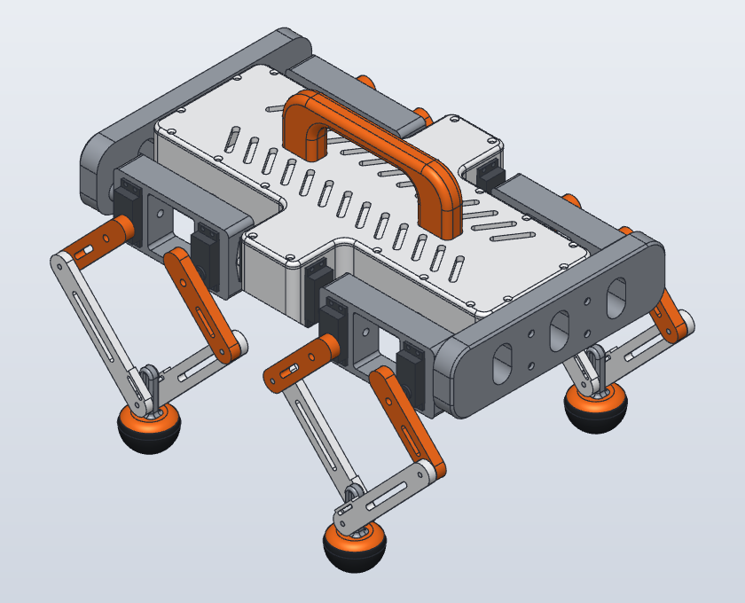

# Robot Dog

A 3D-printable quadruped with 12 MG996R servos and five-bar legs, designed in [SolidCraft](https://github.com/bherbruck/solidcraft).

> **Status:** designed and checked in CAD. It has not been printed or test-fitted yet, so print one coxa and try a real servo in it before printing everything.

## Specifications

| | |
|---|---|
| Overall size, neutral pose | 406 × 306 × 287 mm (length × width × height) |
| Actuators | 12 × MG996R: per leg, 1 hip roll and 2 driving the five-bar |
| Leg geometry | Upper link 60 mm, lower link 120 mm, servo shafts 82.5 mm apart |
| Foot | Ø48 mm ball with a replaceable TPU boot, 47 mm from foot pin to ground |
| Joints | No bearings. M4 bolts at the knees and feet, printed Ø8 mm pins at the hips |
| Fasteners | M3 and M4 throughout, see [BOM.md](BOM.md) |
| Estimated mass | 2.6–3.6 kg, assuming 0.45 kg of battery and electronics |

## Files

| File | What it is |
|---|---|
| [`BOM.md`](BOM.md) | Every component, what to buy, and where each fastener goes |
| `solidcraft/robot_dog_assembly_v8.solidcraft` | The full parametric assembly with 40 joints |
| `stl/` | One mesh per printed part, 33 in total |
| `step/` | The same 33 parts as CAD solids, with matching names |

Every STL and STEP file is exported in the assembled neutral pose and shares one coordinate system, so importing all 33 rebuilds the robot in place. Rotate each part flat in your slicer.

## Printing

Print each file in `stl/` once. The four `FootBoot_*_TPU` parts are TPU (85A–95A), and everything else is PLA or PETG.

**Bed size:** `Chassis` (360 × 230 mm) and `TopPlate` (359 × 230 mm) need a bed of at least 360 × 230 mm. They don't fit a 256 mm bed and aren't split yet. Everything else fits a 256 mm bed.

These settings are untested starting points:

| Part | Orientation | Notes |
|---|---|---|
| `Chassis` | As modelled, floor down | Low infill. It's 1 L of plastic if solid. |
| `TopPlate` | As modelled, flat | |
| `BarFront`, `BarRear` | As modelled | Keeps layers along the Ø8 pins. Support under the pins. |
| `Handle` | On its side | No support across the hand opening |
| `Coxa_*` | Long axis on the bed | 4 or more walls |
| `Upper*`, `Lower*` links | Flat on a broad face | 4 or more walls, 40% infill or more |
| `Foot_*` | Mast up | Support under the ball |
| `FootBoot_*_TPU` | Open end down | Print one first to test the fit |

## Assembly

Before fitting any horn, drive every servo to centre (1500 µs). Remove the rubber grommets.

1. **Hip servos.** Feed each cable down through its pocket in `Chassis`, because the cable nub is at the servo's lower end. Drop the servo in and fit 4 × M3 × 16 with washers.
2. **Coxas.** On the bench, screw a horn into each coxa with 2 horn screws. Press the coxa onto its hip servo spline, level with the body. Fit the centre screw through the Ø6.5 mm bore along the coxa axis, from the pivot end. This needs a driver at least 125 mm long and has to happen before the leg servos go in.
3. **Leg servos.** Fit two per coxa, passing the cable nub through its notch in the pocket wall, with 4 × M3 × 16 and washers each.
4. **Upper links.** Screw a horn into each link with 2 horn screws, press it onto the servo spline at the neutral angle (about 44° outward from straight down), and fit the centre screw through the Ø6 mm hole in the link.
5. **Lower links and foot.** Fit `LowerIn` and `LowerOut` to the foot with the M4 × 35 foot pin, then fit the M3 × 35 cross pin through both lower link slots and the foot mast slot. Keep the cross pin loose.
6. **Knees.** Join each upper and lower link with M4 × 25. The inner knee's head goes in the recess on `LowerIn`, facing the body, with no washer. [BOM.md](BOM.md#where-each-fastener-goes) lists which side each head and nut goes.
7. **Boots.** Press a TPU boot onto each foot. A drop of glue is optional.
8. **Static bars.** Slide the bar pins into the coxa bores and fit 4 × M3 × 25 per bar.
9. **Wiring.** See below. Do this while the top is open.
10. **Top.** Bolt the handle to `TopPlate` from underneath with 4 × M3 × 25, because those screws can't be reached afterwards. Then fit the plate with 20 × M3 × 16 countersunk screws.

Horn splines only engage at fixed steps, so a link may sit a few degrees off neutral. Trim that out with a software offset per servo.

## Wiring

- **Hip servos:** each cable leaves the bottom of the servo, through a hole in the pocket floor and along a channel into the body.
- **Leg servos:** each cable leaves its pocket through a slot in the coxa wall. Bend it inboard and up along the underside of the servo, then into the body through the nearest Ø18 mm port in the side wall. There are four ports, and an 18 mm hole passes a 3-pin connector.
- **Length:** the stock lead is 30 cm, per the datasheet.
- **Slack:** leave 30–40 mm of loop at each hip so the coxa can roll.
- **Keep clear of** the coxa's lower inner corner, where the gap to the body closes to 2.6 mm at full inward roll.

The cable path is calculated from the geometry, not simulated. Check it with your real cables.

## Kinematics

Coordinates are X forward, Y left and Z up, with the origin at the body centre on the hip axis height.

| | |
|---|---|
| Hip roll axes | Along X at Y = ±92, Z = 0 |
| Leg servo shafts | Along Y at X = ±68.75 and ±151.25, Z = −10.15 (at zero hip roll) |
| Upper link, lower link | 60 mm, 120 mm |
| Foot pin at neutral (the end effector) | X = ±110, Z = −140.15, which is 130 mm below the shafts |
| Foot pin to ground contact | 47 mm |
| Ground contact at neutral | Z = −187.15 |

All joint angles are zero at the neutral pose. Shaft angles turn right-handed about +Y. Right legs take the same shaft angles as left legs, and rear legs take negated angles.

**Limits to enforce in software:**

| | |
|---|---|
| Hip roll | ±35° |
| Leg servo shafts | ±80° mechanically. The datasheet gives about ±60° of servo travel, though many sellers list 180°, so measure yours. |
| Foot pin depth below the shafts | 44.7–170 mm at ±80°, or 52.7–170 mm at ±60°. The cross pin reaches the end of its slot at about 173 mm. |

At the 130 mm neutral depth, the foot pin can move 83 mm fore or aft at ±80°, or 72 mm at ±60°.

The foot stays centred between the two lower links, so it tilts as the leg leans and the rounded sole rolls through that tilt.

**Load (hand estimate):** at 2.7 kg, each leg servo sees about 0.27 N·m standing and 0.55–0.67 N·m at a trot, against a stall torque of 0.92–1.08 N·m. Standing and slow walking are fine. A trot is marginal, and it gets worse towards the top of the mass range. Thinner body walls are the biggest saving.

## Verification

| Check | Result |
|---|---|
| Part overlap, 73 bodies | Zero, at neutral and with all four hips at ±35° |
| Joints | 40 joints, no conflicts, no timeline errors or warnings |
| Leg motion against the analytic five-bar | All four legs within 0.00005 mm at 7 poses |
| Foot clearance | Clear of the links, cross pin, coxa and body at 5 worst-case poses, front-left leg only |
| Knee bolt hardware | Clear across 1510 reachable poses (2D calculation) |
| Hole sizes and depths | Measured on the solids against the fastener stacks in [BOM.md](BOM.md) |
| Servo dimensions | Length, width, height, flange height and ear span match the datasheet drawing |
| STL files | 33 watertight, within 0.13% of the CAD volume |
| STEP files | 33 valid single solids, within 0.004% of the CAD volume, and within 0.012 mm of the matching STL's bounding box |

These checks show the model agrees with itself and with the datasheet. Print fit, servo strength, foot grip and cable routing can only be confirmed on a real build.

## Check these before printing everything

Measure these with calipers on your own servos. If any differ, change the parameter in the design and re-export.

| Measure | Value in the model | Parameter |
|---|---|---|
| Cable nub width (estimated, not on the datasheet) | 5.4 mm, in a 5.8–7 mm notch | `sv_nub_w`, `nub_tip_w`, `nub_root_w` |
| Servo ear hole spacing, along the body | 49 mm | `hole_l` |
| Servo ear hole spacing, across the body | 10 mm | `hole_w` |
| Horn length, tip to tip | 39 mm | `horn_len` |
| Horn hub diameter | 11 mm | `horn_hub_d` |
| Horn arm tip width | 5 mm | `horn_tip_d` |
| Horn screw hole, distance from the axis | 16.3 mm | `horn_screw_r` |

Boot tightness is set by `foot_boot_fit`, and the servo pocket clearance by `servo_fit`.

## Sources

- [TowerPro MG996R datasheet](https://people.ece.cornell.edu/land/courses/ece4760/FinalProjects/f2017/kmv48_rp625/kmv48_rp625/kmv48_rp625/MG996RTowerPro.pdf)
- [MG996R product page and photos](https://probots.co.in/mg996r-13kg-metal-gear-servo-180.html)
